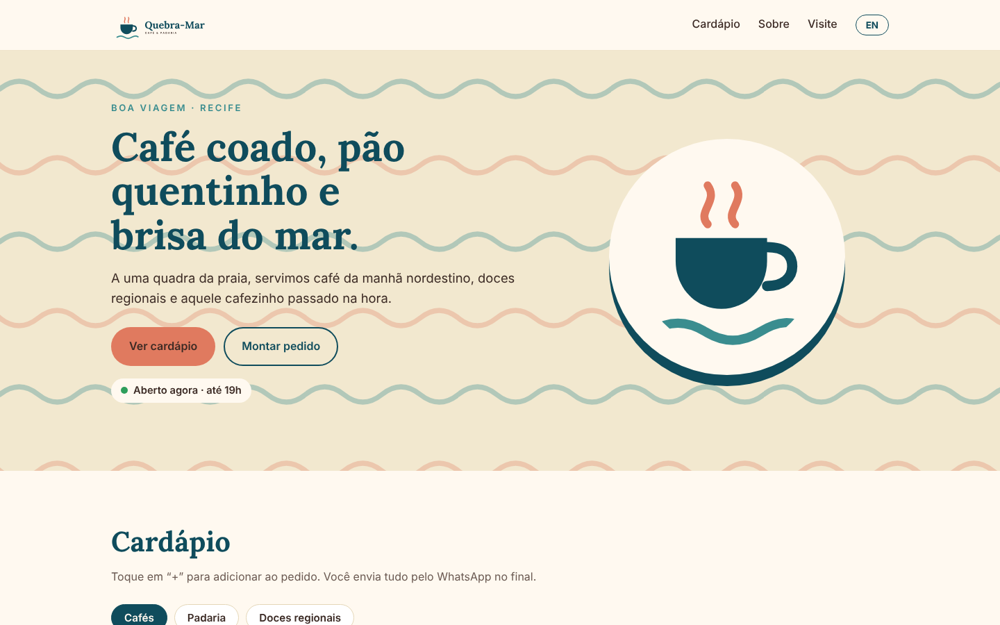
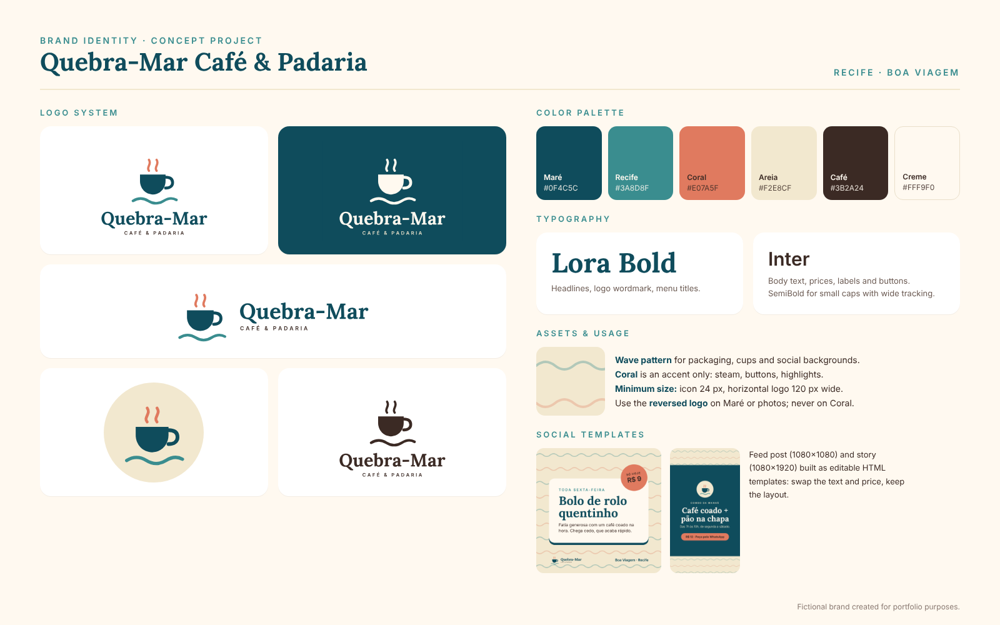
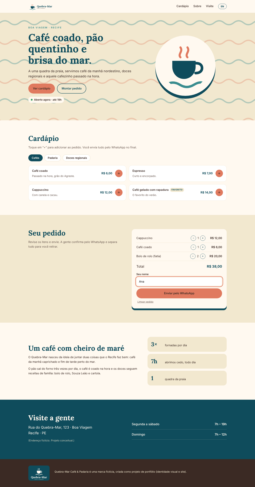
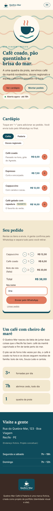

# Quebra-Mar Café & Padaria: brand identity + website

**Live site:** https://gianccsbb.github.io/quebramar-site/

> **Concept project.** Quebra-Mar is a fictional café in Boa Viagem, Recife, created to show a complete small-business package: visual identity, social media templates and a working website. The address and business are fictional.



## What's included

### Brand identity (`brand/`)
| File | Use |
|---|---|
| `logo/logo-primary.svg` | Main stacked logo |
| `logo/logo-horizontal.svg` | Website header, documents, wide spaces |
| `logo/icon.svg`, `logo/icon-badge.svg` | Favicon, app icon, social profile picture |
| `logo/logo-mono-dark.svg` | One-color version for stamps, receipts, packaging |
| `logo/logo-mono-light.svg` | Reversed version for dark backgrounds |
| `logo/pattern-waves.svg` | Seamless pattern for packaging and backgrounds |
| `logo/png/` | Transparent PNG exports of every logo (4× resolution) |
| `brand-sheet.png` | One-page brand guide: logos, palette, typography, usage rules |
| `social/` | Instagram feed post (1080×1080) and story (1080×1920) |
| `src/` | Editable HTML sources for the brand sheet and social templates |

The logo text is converted to vector outlines, so the files look the same on any computer, with no fonts to install.

**Palette:** Maré `#0F4C5C` · Recife `#3A8D8F` · Coral `#E07A5F` · Areia `#F2E8CF` · Café `#3B2A24` · Creme `#FFF9F0`
**Typography:** Lora Bold (headlines) and Inter (body, prices, buttons)



### Website (`docs/`)
A single-page, responsive site in plain HTML, CSS and JavaScript (no framework, no build step).

- **Menu with category tabs**, keyboard accessible (arrow keys switch tabs)
- **Order builder:** customers add items, adjust quantities and see the running total
- **WhatsApp hand-off:** the order is turned into a ready-to-send WhatsApp message with items, total and the customer's name
- **Open/closed indicator** computed from the opening hours in Recife's time zone
- **Portuguese/English toggle** (useful for tourists in Boa Viagem)
- The order and language choice survive a page reload
- Prices are handled in cents, so totals never show rounding errors

To set the real WhatsApp number, edit `WHATSAPP_NUMBER` at the top of `docs/app.js` (international format, digits only). It's empty in this demo, so WhatsApp asks which contact to send to.

## Run it locally
```bash
cd site
python -m http.server 8000
# open http://localhost:8000
```

## Publish it (free)
The site lives in `docs/`, so GitHub Pages serves it directly: Settings → Pages → Deploy from a branch → `main` / `/docs`. Netlify and Cloudflare Pages also work by dragging the folder in.

## Screenshots
| Desktop | Mobile |
|---|---|
|  |  |
